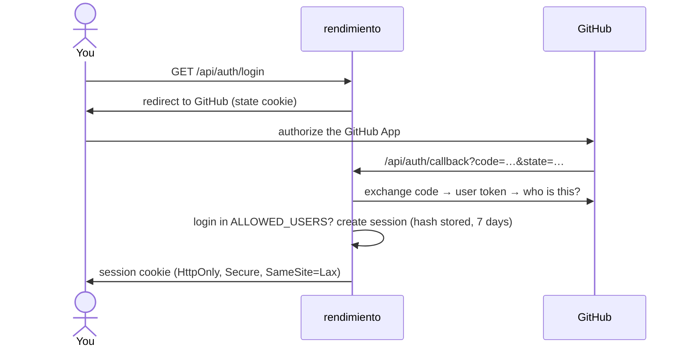
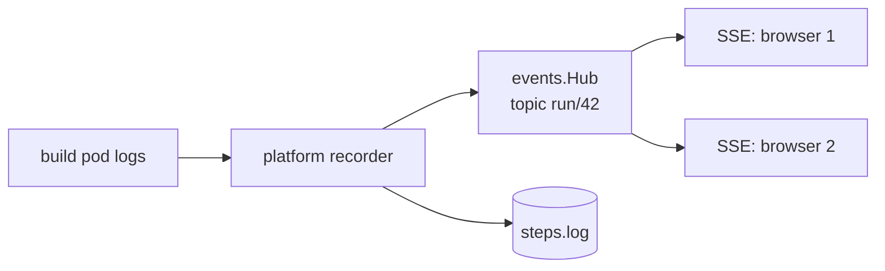
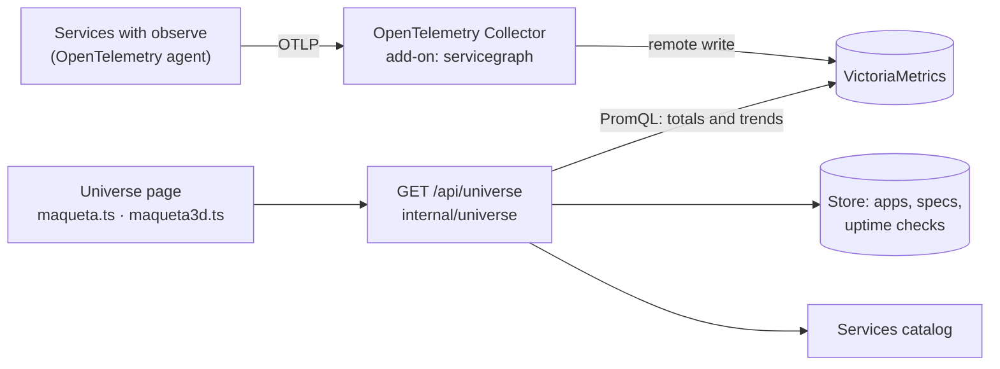

# API, auth and the UI

## The HTTP server

`internal/api` serves everything on one port (8080) with Go's standard `net/http` router, which since Go 1.22 matches methods and path patterns (`"GET /api/apps/{app}"`) with no framework. `Server.Handler()` registers three kinds of routes:

| Kind | Examples | Protection |
|---|---|---|
| public | `/healthz`, `POST /api/webhooks/github`, `/api/auth/*`, `/api/setup/*` | webhooks: HMAC signature; setup: the setup token |
| session | every other `/api/…` route | a valid session cookie for an allowed GitHub login |
| UI | everything else | none (static files) |

The whole list is in the [HTTP API reference](../reference/api.md). Handlers are thin: they decode the request, call the platform, store or cluster, and write JSON with `writeJSON`/`httpError`. Business logic lives in `internal/platform` and the controllers, not in handlers.

## Signing in

Before signing in, people see the **welcome page** (`web/src/pages/Bienvenida.tsx`): what *rendir* means, how the platform works, how it works with AI agents (la Ruta), and a link to the book (`BOOK_URL`, `BOOK_URL_ES`). With `PUBLIC_ACTIVITY=true` it also shows *Right now*: what is building and the latest releases, by app name only. Everything on it is public, so it says nothing about the installation.

- Sessions are random 32-byte tokens; only their **SHA-256** is stored, so a database leak does not leak sessions.
- `requireSession` checks the cookie **and** the allowlist on every request, so removing someone from `ALLOWED_USERS` locks them out immediately.
- `guard` adds security headers (`nosniff`, `DENY` framing, same-origin referrer) and refuses **cross-origin** state-changing requests (the `Origin` header must match), on top of `SameSite=Lax` cookies.

## Webhooks

`POST /api/webhooks/github` verifies the `X-Hub-Signature-256` HMAC with the App's webhook secret (constant-time comparison), then handles **push** events: to an app's repository (runs) and to the gitops repository (add-on sync). Pull-request events need no handling: the branch's push already built it, and its check run shows on the PR. **Pull requests from forks are never built**, since their code would run with the installation's token.

## Live updates: Server-Sent Events

Run pages and app pages update live. The browser opens `GET /api/runs/{id}/events` (or `/api/apps/{app}/events`), a long-lived response with `Content-Type: text/event-stream`; the server writes `event:`/`data:` lines as things happen, and a comment every 20 seconds to keep proxies from closing it.

`events.Hub` is an in-process publish/subscribe map from topic to subscriber channels. Publishing never blocks: a subscriber that falls behind misses events and refetches state when it reconnects. It is the simplest thing that works with one replica; with several replicas it needs a shared bus ([Scaling](../future/scaling.md#live-updates-across-replicas)). The ingress for the platform disables proxy buffering and allows hour-long reads, so events flow immediately.

## The UI

A single-page app in `web/`: **React 19**, **TypeScript**, **Vite**, **react-router**, no UI framework, and one stylesheet with CSS variables for light and dark themes.

| File | Role |
|---|---|
| `src/main.tsx` | Routes, top bar, sign-in gate |
| `src/api.ts` | Every API call and response type, in one place |
| `src/components/ui.tsx` | Shared pieces: badges, `usePoll` (load and refresh), `Switch`, the resource tree |
| `src/pages/*.tsx` | One file per page: Dashboard, NewApp, AppPage, RunPage, Services, Universe, Addons, Installed (add-on list, catalog, detail), Mercado, Ruta, Problems, Environment, Version, Setup |
| `src/components/maqueta.ts` | The Universe's village, drawn on a canvas ([below](#the-universe)) |
| `src/components/maqueta3d.ts` | The same village in 3D, with three.js |
| `src/styles.css` | Theme tokens and components |

Patterns used throughout:

- **`usePoll(load, deps, intervalMs)`** fetches data and refreshes it on an interval; pages combine it with SSE where updates must be instant (logs).
- **Types mirror the Go JSON.** `api.ts` declares interfaces matching the Go structs' JSON tags; keeping them in sync is manual today ([refactoring](../develop/refactoring.md#share-types-between-go-and-typescript)).
- **No global state library.** Each page owns its data; there is little shared state to justify one.

## The Universe

The [Universe](../guide/universe.md) page joins what rendimiento knows about every app into one graph, and draws it as a village.

- **`universe.Build`** makes the graph: a *system* per app (or per namespace for what rendimiento does not deploy), its *nodes* (services, databases, caches, jobs), and *edges* from `needs:`, from environment variables (the catalog), from Ingresses and from traces. **`barrios`** then puts every system in a barrio: the app's own `barrio:`, else the barrio of the apps it talks to most (label propagation over the edges between apps, weighted by measured calls), else the centre; non-apps go to the outskirts.
- **`Metrics.Edges`** reads the service graph the collector writes: instant queries for the window's calls, failures and p50/p95 (the larger of the caller's and the callee's), and range queries for their trends (`TrendPoints`, 24 points). The map is still served when the metrics store does not answer. **`Metrics.Spans`** does the same for one service from the collector's span metrics (`/api/universe/spans`), leaving out the ASGI middleware's `… http send` pieces.
- **The page** (`pages/Universe.tsx`) turns the graph into what is drawn: the status of every node, pueblo and barrio, and the roads between pueblos and between barrios with their calls summed. **`components/maqueta.ts`** lays the barrios out on a grid and the pueblos inside them, draws them in isometric projection on a canvas every frame (so the fireflies move), keeps the screen position of everything drawn for taps (a road takes a tap within 12 px), places labels so they do not cover each other, and glides the camera between levels. The level and place live in the address, so the browser's back button works.
- **The 3D view** (`components/maqueta3d.ts`) takes the same model and the same layout (`placeWorld`, `placeInside`, shared with `maqueta.ts`) and builds it with [three.js](https://threejs.org): a tile is one unit, the scene is rebuilt from scratch on every change (a few hundred pieces), `MapControls` move, turn and tilt the camera, a ray finds the thing under a tap (an invisible cylinder stands for each house or pueblo), roads are still found on screen within 12 px, and the labels are drawn on a 2D canvas above it with the same code as in 2.5D. Both maquetas implement `Engine` (`set`, `zoom`, `fit`, `destroy`, and `turn` in 3D), so the page does not care which is showing. The page loads the 3D file with a dynamic `import()`, so three.js (about 150 KB compressed) is downloaded only by those who choose 3D.

### How the UI ships

`npm run build` compiles `web/src` into `web/dist`. `web/embed.go` embeds that folder into the Go binary (`//go:embed all:dist`), and `Server.ui()` serves it: static assets with a year-long cache (their names contain a content hash), and `index.html` for any other path so client-side routes work on reload. The Docker build compiles the UI in its own stage ([builds](builds.md#rendimientos-own-dockerfile)).

For UI work, `npm run dev` in `web/` starts Vite's dev server with hot reload, proxying `/api` to a rendimiento on `localhost:8080` ([setup](../develop/setup.md#working-on-the-ui)).
