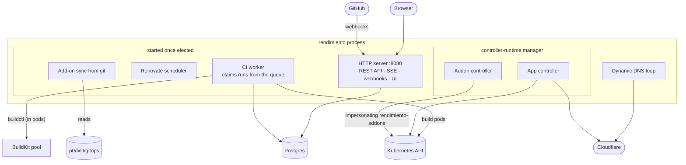
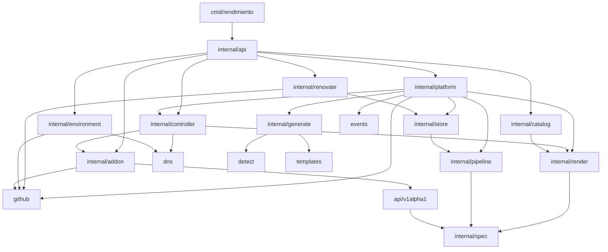

# Big picture

## One binary, several jobs

rendimiento is a single Go program (`cmd/rendimiento`) that does four jobs at once. Each job is a set of goroutines inside the same process:



| Job | Package | What it does |
|---|---|---|
| **API and UI** | `internal/api` | Serves the React UI (embedded in the binary), the JSON API, live updates over Server-Sent Events, GitHub webhooks, login and the GitHub App setup. |
| **Orchestration** | `internal/platform` | Turns webhooks into CI runs, runs into releases, releases into `App` objects. Onboarding, rollback, delete and disconnect live here. |
| **CI** | `internal/pipeline` | Plans a run as a graph of steps and runs each step as a pod; builds go to the BuildKit pool. |
| **App controller** | `internal/controller` | Reconciles each `App` into namespaces, Deployments, Services, Ingresses, volumes, CronJobs, DNS records and status. |
| **Add-on controller and sync** | `internal/controller`, `internal/addon` | Keeps `Addon` objects in line with `p0dxD/gitops/addons/*.yaml` and reconciles each into the objects its Helm chart or manifests describe. |
| **Built-in add-ons** | `internal/renovate` | Renovate runs on a schedule. |
| **Views** | `internal/catalog`, `internal/environment` | The Services page and the Environment page. |

### Services from one binary {#three-services}

The same image runs as four Deployments, chosen by the `ROLE` setting, so a failure stays in one service, with its own logs, health and restarts:

| Service (`ROLE`) | Deployment | What it runs | Only one active, by |
|---|---|---|---|
| `api` | `rendimiento` (2 replicas) | the UI, the API, webhooks, MCP, the public stats | nothing: every replica serves |
| `control` | `rendimiento-control` | the App and Addon controllers, Renovate, the add-on sync, the uptime prober, release verification, the log archive, dynamic DNS | the leader lease |
| `worker` | `rendimiento-worker` | the CI queue: build and test pods, deploys | the queue's lock in Postgres |
| `agents` | `rendimiento-agents` | the agents inside the platform: the [diagnostician](../guide/agents.md#agents-inside-the-platform) explains every failed run through the AI gateway | the agents' lock in Postgres |
| `traces` | `rendimiento-traces` | receives every span from the OpenTelemetry Collector and keeps whole requests for the Universe's [waterfall](../guide/universe.md#following-one-request) | one replica (a request's spans wait in its memory) |

`ROLE=all` (the default) runs everything in one process, as on a laptop. The services share nothing but Postgres and Kubernetes:

- **live events** (log lines, step changes) go through Postgres `LISTEN/NOTIFY` ([`events.Bridge`](api-ui.md#live-updates-server-sent-events)), so a run page served by `api` follows a build on `worker`;
- **requests** go the same way, with an answer: `api` asks `control` to start a Renovate run or for the last add-on sync, and gets an error at once when `control` is down instead of a hung page; a cancel reaches the worker running the run; a deploy hands the new release's verification to `control`;
- CI runs are queued in Postgres by `api` and claimed by `worker`.

The control service and the worker serve only `/healthz` on their HTTP port; the traces service serves only its receiver (`TRACES_LISTEN`) and needs no Kubernetes or GitHub. Entorno's **Platform services** check shows each Deployment's ready pods (setting `SERVICES`).

### Why "started once elected"?

Some work must happen exactly once in the cluster: scheduling Renovate, syncing add-ons, reconciling. controller-runtime's *leader election* guarantees that only one control process does it; its lease is long (60 seconds), because on a busy Raspberry Pi control plane short renewals timed out and killed the process. During an update the old pod hands the lease over as it stops. Claiming CI runs is guarded by the queue's lock in Postgres instead, so the worker needs no lease.

## How `main.go` wires it together

`cmd/rendimiento/main.go` is the **composition root**: the only place that reads configuration and creates concrete implementations. Everything else receives what it needs as struct fields or interfaces. In order, it:

1. reads settings from the environment ([all of them](../reference/config.md));
2. opens Postgres, runs migrations, requeues runs interrupted by the last restart;
3. creates the controller-runtime **manager** (Kubernetes client, cache, metrics on `:9090`);
4. picks the **DNS provider**: Cloudflare if a token is set (and starts dynamic DNS for `DNS_TARGET=auto`), otherwise `dns.Noop`;
5. builds render **options** (ingress class, issuer, storage class, the GPU profile) and registers the **App controller**;
6. loads the **GitHub App** credentials into a `github.Holder` (empty until setup);
7. creates the **add-on** identity client (impersonating `rendimiento-addons`), the renderer and syncer, and registers the **Addon controller**;
8. creates the **platform**, the **Kubernetes executor** (build namespace, BuildKit pool, Railpack, node exclusions) and the **CI runner**, and the **Renovate runner**;
9. creates the **API server** with all of the above;
10. starts the manager, what its `ROLE` runs (the leader-only loops, the CI worker) and the HTTP server, and waits for a signal or an error.

```go
--8<-- "cmd/rendimiento/main.go:startup"
```

## The packages, in layers

Arrows mean "imports". Lower layers never import higher ones, which keeps each package testable on its own.



- **At the bottom**, `internal/spec` (the `rendimiento.yaml` types) and small leaf packages (`dns`, `detect`, `events`, `github`) depend on nothing of ours.
- **`api/v1alpha1`** defines the custom resources (`App`, `Addon`), reusing the spec types so an `App` carries exactly what `rendimiento.yaml` says.
- **`render`** is pure: spec plus images in, Kubernetes objects out. No I/O, which makes it easy to test with golden files.
- **`controller`** and **`pipeline`** do the I/O against Kubernetes.
- **`platform`** ties CI, the store and GitHub together.
- **`api`** is the outermost layer.

Everything under `internal/` is private to this module (a Go rule): other projects cannot import it. That keeps us free to change it. If parts should become a public library one day, they would move out of `internal/`.

## Where state lives

| What | Where | Why there |
|---|---|---|
| What should run for each app (services, jobs, released images) | `App` objects in Kubernetes | Controllers watch them; `kubectl` can see and fix them; the cluster works without the database. |
| App configuration | `rendimiento.yaml` in each repo | GitOps: reviewed, versioned, and changes deploy on merge. |
| Add-on definitions | `p0dxD/gitops/addons/*.yaml` → `Addon` objects | Same reasons, for cluster software. |
| CI runs, steps, logs, releases, sessions, add-on settings and runs | Postgres | Relational history, a work queue, large text (logs). |
| Secrets | Kubernetes Secrets (sealed secrets in git for apps that use them) | Never in git in plain text, never in Postgres. |

More in [Data and state](data.md).

## The UI

A React + TypeScript single-page app (`web/`), built with Vite into `web/dist` and **embedded into the Go binary** with `//go:embed`. There is no separate web server: the binary serves the files and falls back to `index.html` for client-side routes. See [API, auth and the UI](api-ui.md).
