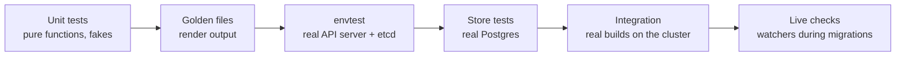

# Testing

## The kinds of tests



| Kind | Where | Needs | What it proves |
|---|---|---|---|
| **Unit** | every package | nothing | parsing, validation, planning, detection, hashing, log parsing… |
| **Golden** | `internal/render` (`testdata/*.golden.yaml`) | nothing | the exact Kubernetes objects a spec renders to |
| **envtest** | `internal/controller`, `internal/platform` | a test API server and etcd (downloaded by `setup-envtest`) | controllers against a real Kubernetes API: apply, adoption, pruning, hooks, needs, finalizers |
| **Store** | `internal/store`, `internal/api`, `internal/platform` | Postgres (`TEST_DATABASE_URL`) | SQL, migrations, the run queue, sessions |
| **Integration** | `internal/pipeline` (build tag `integration`) | the cluster's BuildKit pool | a real Dockerfile build and a real Railpack build, pushed with a digest |
| **UI** | `web` | Node | the TypeScript compiles (`npm run typecheck`) |
| **Browser** | `web/e2e` | Playwright, Postgres, Go | the real UI and API in a browser, in English and Spanish: "New app" with every example of `internal/spec/ejemplos`, then every page in the menu, with no error in the browser and no 500 from the API ([below](#browser-tests)) |

## Running them

```bash
make test-remote                                 # everything, on a worker (use this)
go test ./internal/spec ./internal/render        # light packages, fine anywhere
go test ./internal/render -run Golden -update    # rewrite golden files after an intended change
make itest                                       # real builds on the BuildKit pool (minutes)
```

## Remote tests

`make test-remote` (`hack/test-remote.sh`) runs the steps of `make test` in a pod on a worker, because compiling and running envtest on `main` (the control plane) slows the whole cluster:

```bash
--8<-- "hack/test-remote.sh:95:115"
```

1. A pod with three containers is created in `rendimiento-builds`, avoiding the control plane and any `TEST_EXCLUDE_NODES`: **go** (the toolchain), **node** (the typecheck) and **postgres** (a sidecar the store tests use on `localhost`).
2. A **node-local cache** volume (`rendimiento-test-cache`, local-path) keeps Go modules, the build cache, envtest binaries and npm's cache between runs; the first run fills it (about 20 minutes), later runs reuse it.
3. The working tree, **including uncommitted changes**, is streamed in as a tarball.
4. `hack/ci-test.sh` runs `controller-gen`, `go vet` and `go test -p 1 ./...`, then `npm run typecheck` runs, their output streamed here:

    ```bash
    --8<-- "hack/ci-test.sh:25:37"
    ```

5. Regenerated files are copied back, so the repository matches what was tested.
6. The pod is deleted.

`-p 1` runs packages one after another: the store, platform and API tests share one database.

## On every push {#on-every-push}

rendimiento's own repository is an app on rendimiento: its `rendimiento.yaml` lists the book (a service) and the platform's image (`builds: platform`). So every push and pull request also runs the same `hack/ci-test.sh`, as the `platform:test` step, with a throwaway Postgres (`postgres: true`) and a kept cache (`cache: true`); then `platform:build` builds the image, whose Dockerfile runs `npm run typecheck`. The result is the check on the commit in GitHub. In CI the script also fails when the generated files (deepcopy, CRDs) were not committed (`CHECK_GENERATED=1`). A pull request **from a fork** is never run by rendimiento (its code would run with the installation's token); `.github/workflows/forks.yml` runs `hack/ci-test.sh`, the book and the browser tests for it on GitHub's machines, with no secret. `make test-remote` is still the way to test **uncommitted** changes. See [How rendimiento builds itself](../environment/deploy.md#rendimiento-builds-itself).

## Browser tests {#browser-tests}

The `interfaz` task of `rendimiento.yaml` runs `hack/ci-interfaz.sh` in the Playwright image on every push, with the task's throwaway Postgres and kept cache (Go is installed there the first time). It builds the UI and `hack/interfaz`, a server with the real API on that empty database, as on a computer without Kubernetes, and a fake GitHub that serves every example of `internal/spec/ejemplos` as a repository (and one without a `rendimiento.yaml`). It signs in a person, and Playwright drives the pages (`web/e2e`). Every test fails on an error thrown in the browser, an error in the console, or an API answer of 500 or more, even when what it looked for was there. A new kind of app only needs its example: the wizard test walks every one. With a cache it takes about three minutes.

## Writing tests

### Unit tests: table-driven

```go
for _, tc := range []struct{ yaml, want string }{
	{"services: [{name: a, lan: {ip: 8.8.8.8}}]", "private IPv4"},
} { … }
```

Name what is being checked in the failure message, and include the got/want values.

### Fakes over mocks

Code depends on small interfaces, so tests pass simple fakes: a `fakeExec` that records execution order, a `fakeDNS` that keeps records in a map, a `fakeGit` serving an `fstest.MapFS`, a `fakeSRV` resolver, an `httptest.Server` playing a Helm repository. No mocking framework is needed.

### envtest

`setup(t)` / `setupAddons(t)` start a real API server and etcd, install the CRDs from `deploy/crds`, start the manager with the controller under test, and return a client. Tests create objects and use `eventually(t, what, cond)` to wait (up to 20 seconds) for the controller to act.

envtest has **no kubelet and no controllers besides yours**: pods never run, Deployments never become ready, garbage collection never happens. Tests play those parts when needed: `TestAddonHooks` marks hook pods *Succeeded* or *Failed* by updating their status.

### Golden files

`render_test.go` renders a spec and compares the YAML with `testdata/*.golden.yaml`. An intended change: run with `-update`, then **read the diff** before committing; it is the clearest possible review of what users' workloads will look like.

## What is not covered yet

- the UI beyond "New app" and opening each page (runs, releases, settings);
- end-to-end tests of the whole platform on a disposable cluster (onboard, push, release, rollback);
- load tests of the run queue and many concurrent builds.

These are on the [roadmap](../future/roadmap.md).
