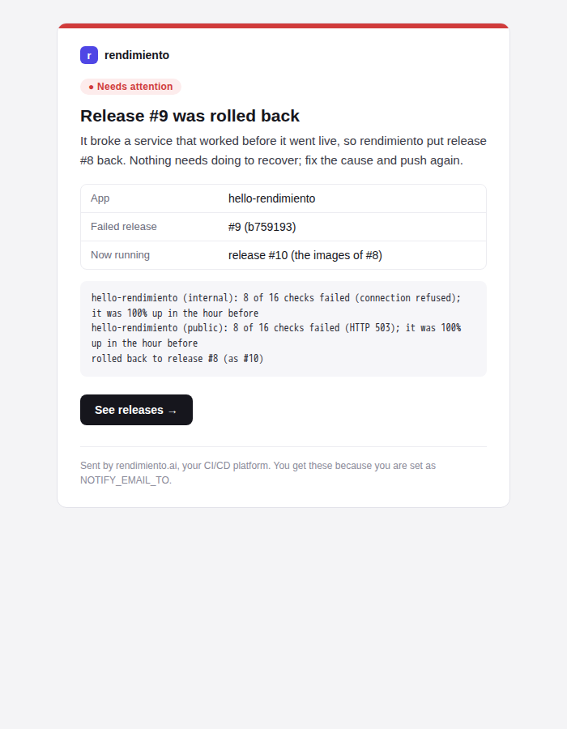

# Notificaciones

rendimiento le envía un correo cuando algo requiere su atención, para que no tenga que estar vigilando la interfaz.



## De qué le avisa {#what-you-are-told-about}

| Evento | Correo | Lo envía |
|---|---|---|
| Una versión **no superó la verificación y se revirtió** | ↩ *aplicación: se revirtió la versión n.º 9*: qué se descompuso y qué se ejecuta ahora | la verificación de versiones (`platform/verify.go`) |
| Una versión no superó la verificación pero **se mantuvo** (`verify.rollback: false`, o no hay a cuál revertir) | ⚠ *aplicación: la versión n.º 9 no superó la verificación* | la verificación de versiones |
| **Falló una construcción de la rama principal**, así que no se publicó nada | ✗ *aplicación: falló la construcción en main*: los pasos que fallaron y sus errores | el trabajador de integración continua (`platform.execute`) |
| Un servicio **se cayó** y siguió caído 5 minutos (`NOTIFY_OUTAGE_AFTER`) | 🔴 *aplicación está caída*: qué comprobaciones, desde cuándo y los errores | las comprobaciones de disponibilidad (`uptime.Prober`) |
| …y **se recuperó**, después de una interrupción de la que se le avisó | ✅ *aplicación se recuperó*, con cuánto tiempo estuvo caída | las comprobaciones de disponibilidad |

Las construcciones de otras ramas y de solicitudes de incorporación no envían correo; su resultado está en la comprobación de GitHub de la confirmación.

## Control del ruido {#noise-control}

Como Alertmanager de Prometheus, rendimiento espera antes de avisarle y junta lo que pasa al mismo tiempo:

- **Una interrupción tiene que durar para que se avise** (`NOTIFY_OUTAGE_AFTER`, 5 minutos). Una interrupción empieza tras dos comprobaciones fallidas y siempre queda registrada en la pestaña [Confiabilidad](reliability.md), pero su correo espera a que haya durado 5 minutos. Si termina antes, no se envía nada: ni el de *caído* ni el de *recuperado*. Un router que se reinicia cada noche a las 3:00, con todas las comprobaciones públicas fallando su DNS durante dos minutos, ya no manda dos docenas de correos.
- **Los avisos de un mismo tipo llegan en un solo correo** (`NOTIFY_GROUP_WAIT`, 2 minutos). La primera caída, recuperación, versión revertida o construcción fallida espera 2 minutos a que lleguen otras del mismo tipo; si llegan, salen juntas: *🔴 shop está caída (y 11 más)*, con una fila por aviso y el color del más grave. Cada tipo se agrupa por separado, y el correo de prueba nunca espera.
- **Un correo por aplicación por cada minuto de cambios.** Cuando varias comprobaciones de una aplicación caen a la vez (su URL pública y su comprobación dentro del clúster), recibe un solo correo que las enumera todas.
- **Sin repeticiones.** El mismo evento (la misma aplicación caída, la misma versión revertida) se envía como máximo una vez cada 30 minutos. Un servicio que se cae y se levanta una y otra vez no envía una avalancha de correos.
- **Un límite de 20 correos por hora.** Pasado ese límite, los correos se descartan y se registran, para que una mala noche no inunde su bandeja.

## Qué contiene un correo {#what-an-email-contains}

- una barra y una etiqueta de color: **Requiere atención** (rojo), **Advertencia** (ámbar), **Resuelto** (verde);
- un título y un resumen de una línea de lo que pasó y de si usted tiene que hacer algo;
- una pequeña tabla de datos (aplicación, versión, confirmación, ejecución, duraciones);
- los errores exactos, en un recuadro;
- un botón a la página indicada: la ejecución, las versiones o la pestaña Confiabilidad.

También hay una versión en texto simple para los programas de correo que no muestran HTML. El diseño usa solo tablas y estilos en línea, que Gmail, Apple Mail y Outlook muestran igual.

## Configuración {#setting-it-up}

El correo se envía a través de [Resend](https://resend.com), desde un remitente en un dominio verificado ahí (aquí `alerts@joserod.space`, compartido con los correos de actualización del clúster y de StockFinancia).

```bash
# la clave de la API, en su propio secreto (lo lee el envFrom de la plataforma)
kubectl -n rendimiento-system create secret generic rendimiento-notify --from-literal=RESEND_API_KEY=re_…
```

| Ajuste | Dónde | Qué significa |
|---|---|---|
| `NOTIFY_EMAIL_TO` | ConfigMap `rendimiento` | Destinatarios, separados por comas. Vacío desactiva el correo. |
| `NOTIFY_LANG` | ConfigMap `rendimiento` | `en` (predeterminado) o `es`: el [idioma](languages.md) de los correos. |
| `NOTIFY_EMAIL_FROM` | ConfigMap | Remitente (de forma predeterminada `rendimiento <alerts@joserod.space>`); debe estar en un dominio verificado. |
| `RESEND_API_KEY` | Secreto `rendimiento-notify` | La clave de la API de Resend. |

Reinicie la plataforma después de cambiarlos. La comprobación *Notificaciones por correo* de la página **Entorno** muestra si el correo está configurado. Su botón **Enviar un correo de prueba** envía un ejemplo al momento y muestra cualquier error del proveedor.

!!! tip "Una clave propia"
    Por ahora la clave es la misma que usa StockFinancia. Una clave de Resend aparte, solo para rendimiento y con permiso únicamente para enviar, se puede revocar sin afectar a las demás aplicaciones.

## En el código {#in-the-code}

| Pieza | Dónde |
|---|---|
| Los mensajes, la plantilla en HTML y en texto, la eliminación de duplicados, el límite por hora y el cliente de Resend | `internal/notify` |
| Los correos de interrupción y de recuperación, agrupados por aplicación en cada ronda | `uptime.Prober.notifyChanges` |
| Los correos de reversión y de ejecución fallida | `platform.verifyMessage`, `platform.notifyRunFailed` |
| El correo de prueba | `POST /api/notifications/test` |

**Para agregar otro canal** (Discord, ntfy, Slack): implemente `notify.Sender`, o convierta un `Message` al formato de ese canal, y elíjalo en `cmd/rendimiento/main.go` a partir de ajustes nuevos. Todo lo que envía notificaciones pasa por `Notifier`, así que la eliminación de duplicados y el límite se aplican a todos los canales.
